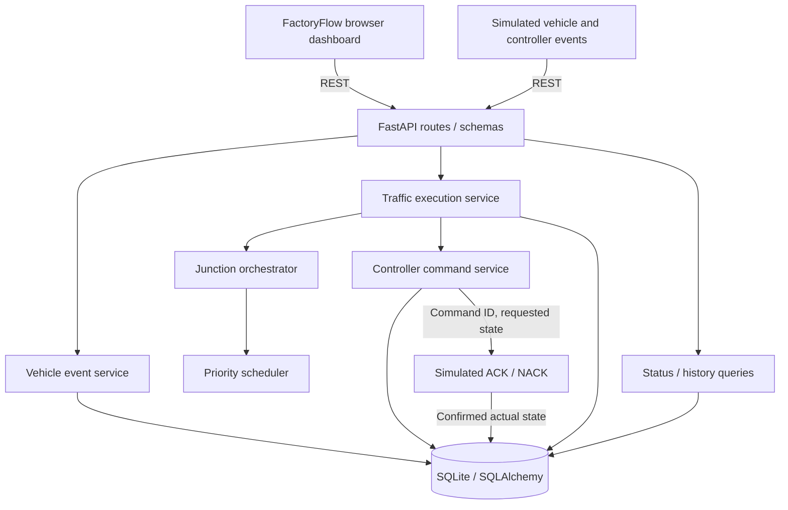

# Factory Traffic Management System


An event-driven, REST-simulated traffic-management application for a factory junction. The backend validates vehicle sensor events, persists direction-based queues, schedules traffic using priority and waiting time, and coordinates safety-oriented traffic-signal transitions with simulated controller acknowledgements. A browser dashboard provides live monitoring and interactive demonstration controls.

> **Scope:** This is an assessment simulator, not software certified to operate physical traffic signals. A REST acknowledgement or ALL_RED confirmation is a simulated assertion, not independent verification of real hardware.

## Quick start

**Requirements:** Python 3.12, pip, and a modern browser. Run all commands from the repository root.

```powershell
# Windows PowerShell (using Conda)
conda create -n factory-traffic python=3.12 -y
conda activate factory-traffic
pip install -r requirements.txt

# Start backend, initialize database, and serve dashboard
uvicorn backend.app.main:app --reload
```

- **Dashboard:** http://127.0.0.1:8000/dashboard/
- **Swagger/OpenAPI:** http://127.0.0.1:8000/docs
- **Health check:** http://127.0.0.1:8000/health (or inspect the app's registered health route in Swagger)

The FastAPI application initializes the SQLite schema and seeds **Junction A** and its four signals at startup. The persistent database is stored at `backend/factory_traffic.db` and is excluded from version control. If the controller starts as `UNKNOWN`, use the **Reconcile ALL_RED** simulator action only after confirming the simulated junction is ALL_RED; an application restart deliberately does not assume previously commanded signals are still physically confirmed.

### Alternative: Python virtual environment

```powershell
python -m venv .venv
.\.venv\Scripts\Activate.ps1
python -m pip install -r requirements.txt
uvicorn backend.app.main:app --reload
```

## Features

- **Vehicle sensor events:** Arrival and clearance processing by junction, vehicle ID, direction, type, sequence number, timestamp, and unique event ID.
- **Idempotency and validation:** Replayed identical event IDs do not double-count queues; conflicting duplicates, stale sequences, invalid values, and impossible clearances are rejected.
- **Persistent queues:** NORTH, SOUTH, EAST, and WEST counts derived from active vehicle records rather than frontend counters.
- **Priority-aware scheduling:** Emergency vehicles first; other traffic scored using vehicle priority, queue size, and waiting time, with a starvation-related waiting bonus.
- **Deterministic traffic execution:** Two nonconflicting phases (`NORTH_SOUTH`, `EAST_WEST`) and controlled GREEN → YELLOW → ALL_RED → GREEN transitions.
- **Manual control:** Operators request a direction's phase or return to automatic mode; they cannot directly force physical signal colors.
- **Emergency preemption:** Emergency requests take precedence over manual and automatic choices while retaining safe transition stages, including interruption during partially acknowledged GREEN activation.
- **Controller simulation:** Persistent commands, ACK/NACK correlation, controller timeouts, confirmed vs. desired signal state, DEGRADED behavior, and reconciliation.
- **Device monitoring:** Simulated sensor, traffic-signal, and controller ONLINE/OFFLINE/DEGRADED events with audit records.
- **Recovery and audit:** Traffic data survives restart; controller confirmation is invalidated until explicit reconciliation. A history API provides operational events.
- **Interactive frontend:** Intersection view, actual signal indicators, queues, operating mode, emergency/failure indicators, vehicle simulator, tick and ACK/NACK controls, manual requests, recent activity, and periodic polling.

## Technology stack

| Layer | Technology |
| --- | --- |
| API | Python, FastAPI, Pydantic |
| Domain | Plain Python domain entities, scheduler, orchestrator, state-machine logic |
| Persistence | SQLAlchemy ORM, SQLite |
| Controller integration | REST simulation with persistent command IDs and acknowledgements |
| Frontend | HTML, CSS, vanilla JavaScript (same-origin API requests) |
| Tests | pytest, FastAPI testing utilities |

## Project layout

```text
factory-traffic-management-system/
├── backend/
│   ├── app/
│   │   ├── api/routes/                   # REST endpoints
│   │   ├── domain/
│   │   │   ├── entities/                  # Traffic and control types
│   │   │   └── services/                  # Scheduler, engine, orchestration, events
│   │   ├── infrastructure/
│   │   │   ├── controllers/               # Commands, ACKs, execution, recovery, health
│   │   │   └── database/                  # SQLAlchemy models, session, initialization
│   │   ├── schemas/                       # Request/response validation
│   │   └── main.py                        # FastAPI entry point / frontend mount
│   └── tests/                             # Automated tests
├── frontend/
│   ├── index.html
│   ├── css/styles.css
│   └── js/
│       ├── api.js                         # API calls
│       └── app.js                         # Dashboard interactions
├── docs/                                  # Optional supplemental documentation
├── requirements.txt
├── .gitignore
└── README.md
```

## Architecture



HTTP endpoints validate and translate requests; domain services handle phase selection and state decisions. Controller and database infrastructure persist commands and confirmed state. The frontend displays backend-provided state and does **not** decide when lights turn GREEN. REST stands in for future MQTT transport; a production implementation would require a dedicated controller adapter and hardware interlocks.

### Data model

The schema currently contains seven tables:

| Table | Purpose |
| --- | --- |
| `junctions` | Operating mode, active/target phase, transition stage/deadline, manual preference, controller status |
| `vehicles` | Individual vehicle arrivals, waiting/cleared state, direction and type |
| `sensor_events` | Unique event IDs, sequence numbers, timestamps and processing outcomes |
| `signal_states` | Direction-level desired color vs. acknowledged actual color |
| `controller_commands` | Command ID, state request, acknowledgement status and expiry |
| `device_statuses` | Latest reported health of simulated sensors, signals and controllers |
| `audit_logs` | Operational events, descriptions, associated details and timestamps |

SQLAlchemy model definitions live in `backend/app/infrastructure/database/models.py`. Database initialization/seeding lives in `backend/app/infrastructure/database/init_db.py`; the repository also contains a migration for the persisted `manual_phase` field. For a new checkout the latest ORM schema is created on first startup. SQLite is appropriate for this single-machine assessment but is not a multi-controller production database.

## Traffic-control algorithm

Junction A uses two compatible direction groups:

- `NORTH_SOUTH`: NORTH and SOUTH can proceed together.
- `EAST_WEST`: EAST and WEST can proceed together.

The controller never intentionally grants conflicting groups GREEN simultaneously.

**Decision priority:** `EMERGENCY > MANUAL > AUTOMATIC`. The oldest waiting emergency is chosen first when emergency vehicles conflict. A stored manual phase preference can resume after emergency traffic clears; otherwise automatic scheduling resumes.

In automatic mode, the phase selection score considers:

- Vehicle type weight: `EMERGENCY = 100`, `TRUCK = 4`, `FORKLIFT = 2`, `EMPLOYEE_VEHICLE = 1`.
- Queue-size term: `2 × number of waiting vehicles`.
- Waiting-time term: approximately `longest wait (seconds) / 10`.
- Additional waiting bonus of `50` when a phase's oldest wait reaches 120 seconds.

The scheduler prefers staying in the current phase on a tie to avoid unnecessary switching. Normal operation targets a minimum GREEN interval of about **30 seconds**; emergency and manual requests can request preemption without skipping safety transitions. The waiting bonus encourages fairness but is **not** a formal mathematical guarantee against starvation under every adversarial traffic pattern.

### Signal transition state machine


All commands are **issued individually** and marked pending until a matching controller ACK. The system records `desired_state` separately from `actual_state`. Signal colors are not considered confirmed merely because the backend issued a command. Pending command timeout (currently **60 seconds** to allow manual Swagger/dashboard testing) or a NACK degrades controller confidence and blocks further normal execution. An emergency detected during partial GREEN activation triggers a controlled abort, completing any outstanding command before the affected GREEN signals pass through YELLOW, RED and ALL_RED clearance.

Stage timing is checked on **explicit ticks** against stored deadlines; request handlers do not sleep. **The demo does not run a background controller clock:** use the dashboard's **Execute tick** button to advance stages after waiting for the required deadlines, then ACK pending commands. Browser polling only refreshes monitoring data; it does not itself drive the signal state machine.

## REST API reference

The authoritative request/response contracts, validation rules and available routes are published at `/docs` (OpenAPI). Main implemented routes:

| Method | Path | Purpose |
| --- | --- | --- |
| GET | `/health` | Basic application health check (confirm displayed route in Swagger) |
| GET | `/api/junctions` | List junctions |
| GET | `/api/junctions/A` | Junction details/configuration |
| GET | `/api/junctions/A/status` | Phase, mode, confirmed signals and queue sizes |
| GET | `/api/junctions/A/history?limit=10` | Recent audit events |
| GET | `/api/junctions/A/devices` | Recorded device health |
| POST | `/api/sensor-events` | Vehicle arrived / cleared event |
| POST | `/api/junctions/A/tick` | Evaluate/advance one traffic-control step |
| POST | `/api/junctions/A/commands` | Manual phase request / return to automatic |
| POST | `/api/controller-events` | Controller ACK or NACK for a command ID |
| POST | `/api/controller-events/reconcile` | Simulated confirmed ALL_RED reconciliation |
| POST | `/api/device-status` | Simulated device health event |

### Example: vehicle arrival

```json
{
  "event_id": "demo-north-arrival-001",
  "junction_id": "A",
  "vehicle_id": "DEMO-N-001",
  "direction": "NORTH",
  "event_type": "VEHICLE_ARRIVED",
  "vehicle_type": "EMPLOYEE_VEHICLE",
  "sequence_no": 1,
  "timestamp": "2026-10-08T07:00:00Z"
}
```

Use `POST /api/sensor-events`. Use a unique `event_id` for each new event. The timestamp above is illustrative; use a current ISO 8601 UTC timestamp when running the demo.

### Example: vehicle clearance

```json
{
  "event_id": "demo-north-clear-001",
  "junction_id": "A",
  "vehicle_id": "DEMO-N-001",
  "direction": "NORTH",
  "event_type": "VEHICLE_CLEARED",
  "vehicle_type": "EMPLOYEE_VEHICLE",
  "sequence_no": 2,
  "timestamp": "2026-10-08T07:02:00Z"
}
```

The clearance must reference an active vehicle with the same exact vehicle ID and an advancing sequence number. A clearance with no matching active arrival is rejected.

### Manual control

Request EAST/WEST through an EAST or WEST direction:

```json
{"command": "MANUAL_GREEN_REQUEST", "direction": "EAST"}
```

Resume automatic control:

```json
{"command": "RETURN_TO_AUTOMATIC"}
```

Send to `POST /api/junctions/A/commands`. Manual requests are **phase intents**; they do not override YELLOW/ALL_RED safety stages.

### Controller acknowledgements and reconciliation

Each `Execute tick` result may return a `pending_command_id`. Send an ACK with the **exact** pending command ID and requested state. For example:

```json
{
  "command_id": "<pending-command-id-from-tick>",
  "junction_id": "A",
  "status": "ACK",
  "actual_state": "GREEN"
}
```

`actual_state` must match the requested color for that command (which might instead be YELLOW or RED). Use `NACK` to simulate failure. Controller reconciliation uses:

```json
{"junction_id": "A", "confirmed_state": "ALL_RED"}
```

Only submit that simulator confirmation when the simulated external controller is assumed to have verified all signals RED. **This endpoint is not hardware verification or a safe reset for physical devices.**

## Demonstration: normal traffic → emergency → recovery

**Preconditions:** Start with a freshly initialized database or clear previous demo vehicles, verify controller health, and reconcile to confirmed ALL_RED. To see actions from a clean state, use the dashboard at `/dashboard/`.

1. **Normal arrival:** In *Vehicle Simulator*, submit `VEHICLE_ARRIVED` for `NORMAL-001`, direction `NORTH`, type `EMPLOYEE_VEHICLE`, sequence `1`. NORTH queue becomes 1.
2. **Normal GREEN:** In *Traffic Controller*, press **Execute tick**. Wait through the initial 2-second ALL_RED hold; tick again. When a command is pending, choose **ACK requested state**, then tick for the next command. After both NORTH/SOUTH GREEN acknowledgements and a final tick, the active phase becomes `NORTH_SOUTH`. EAST/WEST remain RED.
3. **Emergency arrival:** Submit `VEHICLE_ARRIVED` for `AMB-EAST-001`, direction `EAST`, type `EMERGENCY`, sequence `1`. Verify `EMERGENCY` mode and emergency indicator.
4. **Preemption:** Press **Execute tick** and ACK each pending command. Observe NORTH/SOUTH YELLOW, allow at least **5 seconds**, confirm NORTH/SOUTH RED, allow at least **2 seconds** of ALL_RED, then ACK EAST/WEST GREEN. No opposing GREEN should overlap.
5. **Emergency clearance:** Submit `VEHICLE_CLEARED` for `AMB-EAST-001`, direction `EAST`, sequence `2`. EAST queue decreases and emergency indication clears. The application returns to automatic operation unless an earlier manual preference remains active.
6. **Automatic resumption:** If MANUAL is still selected, use **Return to automatic**. Tick/ACK through any needed safe transition. Clear the original `NORMAL-001` using `VEHICLE_CLEARED`, sequence `2`.
7. **Review state/history:** Check `/api/junctions/A/status`, `/api/junctions/A/history`, and the dashboard. Once both demo vehicles are cleared, the queues should be zero (assuming no other vehicles were added).

### Other useful demo scenarios

| Scenario | How to demonstrate | Expected behavior |
| --- | --- | --- |
| Duplicate arrival | Repeat exactly the same `event_id` and payload | No additional queued vehicle |
| Invalid/stale event | Send a clearance with no arrival or non-increasing sequence | Rejected without corrupting queue |
| Truck vs. employee | Add vehicles on competing phases | Priority contributes to scheduler choice |
| Manual override | Request `MANUAL_GREEN_REQUEST`, then tick/ACK | Safe transition; no direct arbitrary GREEN |
| NACK/failure | NACK a pending controller command | Controller DEGRADED; normal execution blocked |
| Device OFFLINE | POST a sensor or controller `OFFLINE` status | Device recorded, controller execution blocked |
| Restart | Restart Uvicorn with existing database | Queues/history persist; actual signal confirmations become UNKNOWN |

## Testing

Run tests from the repository root:

```powershell
python -m pytest backend/tests/ -v
```

**Last manually reported result:** `66 passed, 1 warning` (October 8, 2026). Test coverage includes domain logic, sensor-event idempotency, persistence, manual control, emergency preemption, ACK-gated phase switching, controller failure/recovery, and device monitoring. Run the suite again before submission; that result is a development checkpoint, not a claim of full production verification.

### Recommended final checks

- Verify no conflicting GREEN in both logical phases while testing each transition.
- Verify ACKs only update actual signal states after controller confirmation.
- Verify duplicate events do not increase queues.
- Verify a pending GREEN ACK does not allow a conflicting emergency GREEN.
- Verify failure/restart leaves states UNKNOWN or blocked until appropriate simulated reconciliation.
- Check dashboard/API errors rather than assuming HTTP success.

## Consistency, timestamps and restart behavior

**Concurrency:** SQLite `BEGIN IMMEDIATE` write transactions serialize critical queue/traffic-control changes for this assessment. This limits races among near-simultaneous requests on the same SQLite database; it is not a substitute for distributed coordination in a multi-process, multi-controller deployment.

**Events:** `event_id` is used for duplicate detection. Per-vehicle `sequence_no` rejects stale ordering. Sensor-supplied timestamps are retained for event context; server receipt and persisted event state are separately tracked. Queue membership changes only on valid arrival/clearance events, not just when a GREEN signal appears.

**Restart:** The database preserves vehicles, sensor records, manual preference and audit history. At startup, controller recovery invalidates unverified actual colors, marks the controller UNKNOWN, and does not blindly resume pending actuation. After a simulated ALL_RED reconciliation, traffic operation can resume.

## Assumptions / Questions / Requirement Issues

1. **Junction scope:** The implementation demonstrates Junction A with four directions and two compatible phases. Additional junctions would require configuration, controller-device definitions and more testing.
2. **Conflicts:** NORTH/SOUTH can receive GREEN together, EAST/WEST can receive GREEN together, but the groups conflict. Turning movements, pedestrian crossings and multi-lane conflicts are outside scope.
3. **Timing:** Approximate 30-second minimum normal GREEN, 5-second YELLOW and 2-second ALL_RED clearance. Timers are persisted and evaluated on explicit ticks rather than an autonomous scheduler.
4. **Priority and fairness:** Emergency outranks manual, which outranks automatic. Multiple competing emergencies use oldest waiting arrival. The waiting bonus mitigates but cannot rigorously eliminate starvation.
5. **Manual persistence:** Manual phase preference remains until explicitly returned to automatic. An emergency temporarily supersedes it; when the emergency clears, the stored preference may resume.
6. **Vehicle departures:** GREEN does not imply clearance. Only a valid `VEHICLE_CLEARED` sensor event removes a vehicle from the waiting queue. Unknown clearances are rejected.
7. **Duplicate/out-of-order data:** Event IDs are idempotency keys. Monotonically increasing per-vehicle sequence numbers determine event freshness; late sensor timestamps alone do not rewrite previously accepted state.
8. **Controller truth:** Desired and acknowledged actual states are distinct. REST ACK/NACK and `confirmed_state: ALL_RED` simulate external assertions and are not independently verified against hardware.
9. **Failure and recovery:** NACK, timeout and device health failures conservatively suspend normal traffic execution. Reconnection is not equivalent to physical reconciliation. **Known safety gap:** the current simulator reconciliation endpoint's hardware/device-health interlocks require further validation; it must not be considered sufficient for a real controller.
10. **Command timing:** The ACK timeout is 60 seconds to support manual demonstration. A production system needs controller-specific timeout/retry policies, duplicate ACK handling, authenticated device messages and command-delivery guarantees.
11. **Partial activation:** The application includes handling for emergency arrival while a GREEN command is outstanding or partially confirmed, but hardware-level behavior under lost messages and power failures is not proven.
12. **REST vs. MQTT:** The assessment permits REST simulation; MQTT transport, broker reconnection and delivery guarantees are not implemented.
13. **Dashboard state:** The UI polls roughly every 3 seconds. It is a demonstration console, not an independent safety controller. Pending command details are tracked in the browser session; after reload, inspect backend command data rather than guessing an ACK ID.
14. **Security and deployment:** No production authentication/authorization, TLS termination, rate limits, redundant control units or audited operator identity. The app is intended for local evaluation only.
15. **SQLite considerations:** SQLite is a pragmatic assessment datastore; robust production workloads need a stronger transaction/concurrency and recovery design with device-state verification.

## Major architectural decisions

- **Domain/API separation:** Traffic phases, queue priority and orchestration are modeled in domain services rather than browser code or HTTP handlers.
- **Explicit persistent stages:** Transitions are stored as states/deadlines to make controller behavior observable and restart-aware.
- **ACK-first control:** Commands record requested state; actual state changes only on accepted simulation feedback.
- **Fail-conservative handling:** When actual signals are uncertain or a controller fails, normal traffic progression is blocked instead of guessing physical state.
- **Simple deployment:** Single FastAPI application serves both API and static frontend, avoiding separate frontend infrastructure for reviewers.
- **SQLite transactional serialization:** Fits a single-instance exercise and protects critical writes better than independent uncoordinated requests.

## Known limitations and future work

- Introduce continuous server-side scheduling/ticking rather than relying on manual demo ticks.
- Require explicit trusted device recovery proof and block reconciliation while mandatory registered devices are unhealthy.
- Expose pending command details through a read endpoint, so dashboard reloads do not lose ACK context.
- Strengthen starvation guarantees, stale emergency expiry, additional junction configuration and concurrency stress tests.
- Add real IoT/MQTT adapter, authenticated controller messages, command retries/reconciliation protocol and independent physical safety interlocks.
- Add authenticated operators, richer failure dashboards, metrics/alerts and a production database for real deployment.

## AI / Tool Usage

**ChatGPT (OpenAI)** was used during development to help plan the architecture, draft and review Python/FastAPI and frontend code, reason about signal safety edge cases, generate test scenarios, troubleshoot failures, and prepare documentation. **VS Code, PowerShell, Swagger/OpenAPI and pytest** were used to implement, run, inspect and test the application. The candidate performed iterative local execution and reported test results and an end-to-end browser demonstration. AI-generated suggestions should be reviewed as code, not treated as proof of correctness; the candidate remains responsible for the submitted design and implementation.

---

**Submission notes:** Include the complete source, `requirements.txt`, the database schema/migration source, this README, and automated tests. Do **not** commit the local SQLite database, virtual environments, secrets or generated caches. Use `/docs` as the API reference and the dashboard's Vehicle Simulator / Traffic Controller sections for evaluator demonstration.
